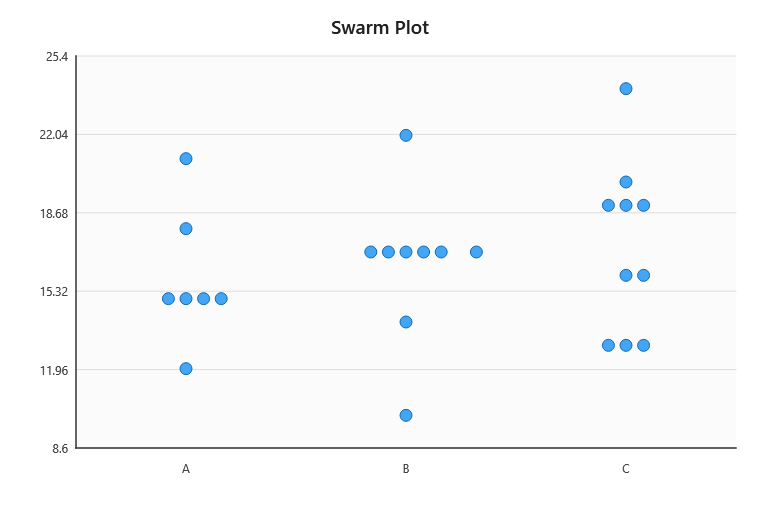

# CPP_GROUP_6_mini_seaborn

## A Modular C++ Data Visualization Library

**Course:** Object-Oriented Programming / C++  
**Programming Language:** C++17  
**Group:** CPP_GROUP_6  
**Institution:** Makerere University CEDAT  
**Group Members:**

| No. | Name | Registration Number |
|---:|---|---|
| 1 | AHAMADA SHAMURAN MUBIRU | 25/08747/PS |
| 2 | OBULUK AGATHA | 25/U/08777/PS |
| 3 | Kazibwe Joshua | 25/U/08582/PS |
| 4 | NANKYA AIDAH F | 25/U/0852 |
| 5 | Namboowa Sylivia | 25/U/08610/PS |
| 6 | MASOKOYI HASSAN KHAKOSI | 25/U/08746/PS |
| 7 | JANEFER MBABAZI | 25/U/0447 |
| 8 | NAKONDE RITAH   | 25/U/08608/PS |
| 9 | MUBIRU JAMADAH  | 25/U/07946/PS |

**Submission Date:** 26th October 2026

---

## 1. Project Overview

### 1.1 Introduction

Mini Seaborn is a modular C++ library implemented from scratch using C++17.
The library generates three types of data visualizations: point plots, swarm
plots, and heatmaps.

A point plot displays the average value of a numerical variable for each
category and uses the plotted values to communicate variation between
observations. A swarm plot displays individual data points for each category
and adjusts their positions to reduce overlap while preserving the
distribution of the data. A heatmap displays relationships between variables
through colour intensity, with darker colours representing stronger
correlations and lighter colours representing weaker correlations.

### 1.2 Project Objectives

The project has the following objectives:

* To develop a modular C++ library for generating data visualizations.
* To implement data validation and preprocessing before plotting.
* To separate plotting logic from rendering and graphical presentation.
* To support multiple visualization types through reusable components.
* To provide plot rendering, scaling, and image export capabilities.
* To apply software engineering principles, including separation of concerns,
  abstraction, and testing.

### 1.3 Implemented Visualizations

The implemented visualizations are:

* Point Plot
* Heatmap
* Swarm Plot

The final outputs are shown below.


*Figure 1: Point plot showing data points connected to illustrate changes
between observations.*


*Figure 2: Heatmap illustrating relationships between features through colour
intensity.*



*Figure 3: Swarm plot displaying individual observations with adjusted
positions to reduce overlap.*

---

## 2. System Architecture and Design

### 2.1 Architectural Overview

The system implements a repeatable and predictable pipeline that begins with
data entry and validation, continues through data transformation and
analysis, and proceeds to plot-specific logic, coordinate scaling, rendering,
and image export. Each stage has a defined responsibility, which allows the
system to remain modular, maintainable, and extensible.

**Input Dataset → Validation → Data Transformation and Analysis →
Plot-Specific Logic → Coordinate Scaling → Rendering → Image Export**

The defined responsibilities make the system predictable and easier to
manage, test, and debug. The modular design also allows additional
visualization types to be introduced without significant changes to the
existing pipeline.

### 2.2 Design Principles

The implementation applies the following design principles:

* **Separation of concerns:** Data validation, plotting logic, rendering, and
  file export are handled by distinct components.
* **Reusability:** Shared data structures and utilities support multiple plot
  types.
* **Abstraction:** Plot-specific behaviour is separated from common plotting
  infrastructure.
* **Extensibility:** Additional visualization types can be introduced without
  redesigning the entire pipeline.
* **Testability:** Individual components can be tested independently of the
  graphical interface.

### 2.3 Core Data Structures

The core data structures include:

* `DataPoint`, which represents a category and its associated numerical value.
* `Dataset`, which stores a collection of data points.
* `ValidationResult`, which communicates whether a dataset is valid and
  records validation errors.
* `DatasetView`, which separates categorical labels from numerical values for
  downstream processing.
* `ObservedRange`, which stores the minimum and maximum observed values.
* `PlotRange`, which defines the numerical range used to construct a plot.

Together, these structures allow data to be represented consistently as it
moves through validation, analysis, transformation, and rendering.

---

## 3. Core Plotting Workflow

### 3.1 Phase One: Data Validation

The first phase ensures that the input data satisfies the requirements for
safe and meaningful processing. The `DataValidator` component provides the
common validation responsibility, while derived plot-specific validator
classes apply the relevant validation rules.

The validation process:

* Rejects empty datasets.
* Checks category labels for validity.
* Rejects non-finite numerical values, including NaN and infinity.
* Collects validation errors in a `ValidationResult`.
* Prevents invalid input from proceeding to subsequent processing stages.

This phase demonstrates the use of object-oriented inheritance. The base
validator class provides shared functionality, while derived validator
classes extend that functionality with plot-specific checks.

The output of this phase is a validation result containing the validity state
and any detected errors.

### 3.2 Phase Two: Data Transformation and Analysis

The second phase converts validated input into a form that plotting components
can process efficiently. The `DataTransformer` component performs the
conversion from validated data to plot-ready data.

For dataset transformation, `createDatasetView()` separates the original
dataset into category labels and numerical values while preserving their
ordering and alignment.

For value analysis, `analyzeValues()` examines the numerical values and
produces an `ObservedRange` containing the minimum and maximum observed
values.

The observed range is then used to derive a suitable `PlotRange`. This range
provides the numerical boundaries required for subsequent coordinate
calculations.

The output of this phase is plot-ready data and the associated numerical
range.

### 3.3 Phase Three: Plot-Specific Logic and Geometry

The third phase determines how processed data is represented visually. Each
visualization has its own plotting logic:

* **Point plot:** Maps observations to positions and connects successive
  points to communicate changes.
* **Heatmap:** Maps feature relationships and correlation values to a grid of
  cells with varying colour intensity.
* **Swarm plot:** Positions individual observations while reducing overlap
  between nearby points.

The plot-specific logic converts processed values into the visual information
required by the rendering layer.

### 3.4 Phase Four: Rendering and Coordinate Scaling

The fourth phase converts plot geometry into a graphical representation. It
has two major responsibilities: coordinate scaling and rendering.

Coordinate scaling:

* Maps data values to positions within the available drawing area.
* Uses the plotting range to determine appropriate coordinate positions.
* Accounts for plot boundaries, margins, and the relationship between data
  coordinates and screen coordinates.

Rendering:

* Draws the visual elements using the rendering layer.
* Produces axes, gridlines, ticks, labels, points, connecting lines, and
  heatmap cells as required by each visualization.
* Uses Qt-based graphical integration to display the resulting plot.

The rendering layer is responsible for presentation, while the plotting logic
determines what should be drawn and where it should be positioned.

### 3.5 Phase Five: Plot Export and Saving

The fifth phase makes generated visualizations available beyond the live
application window. After a plot has been rendered, the export mechanism
captures the graphical output and saves it as a PNG image. The saved images
can be retained, shared, or reused outside the application.

### 3.6 End-to-End Execution Summary

The complete execution process is as follows:

1. The input dataset is received.
2. Its structure and numerical values are validated.
3. The dataset is transformed into a plotting-friendly representation.
4. The values are analysed and the required plotting range is derived.
5. The selected visualization's plotting logic is applied.
6. Drawing positions are calculated through coordinate scaling.
7. The plot is rendered using the graphical layer.
8. The resulting visualization is displayed and saved.

---

## 4. Project Directory Structure

The repository is organized into source code, public headers, tests,
examples, widget implementations, documentation, and generated output
directories. The core library source files are located in `src/`, public
headers are located in `include/`, test programs are located in `tests/`, and
the graphical examples are located in `examples/` and `widget_scaling/`.
Build outputs are generated separately in `build/` and `build-qt/`.

---

## 5. Technologies and Dependencies

The project uses the following technologies and dependencies:

* **C++17:** Core implementation language.
* **CMake:** Build-system configuration and project compilation.
* **Ninja:** Build-file execution and compilation.
* **Qt 6:** Graphical rendering and visualization integration.
* **C++ Standard Library:** Data structures and utilities, including vectors
  and strings.
* **Test executables:** Verification of implemented components.
* **Git and GitHub:** Version control and collaborative development.

---

## 6. Building and Running the Project

### 6.1 Prerequisites

The project requires a C++17 compiler, CMake 3.20 or newer, and Ninja. Qt 6
Widgets is additionally required for the graphical applications. The
compiler, Qt package, and runtime should come from the same toolchain
environment.

### 6.2 Build Instructions

The core library and tests are configured and compiled with:

```bash
cmake -S . -B build -G Ninja \
  -DCPP_GROUP_6_BUILD_POINT_PLOT=OFF
cmake --build build
ctest --test-dir build --output-on-failure
```

The Qt-enabled build is configured separately:

```bash
cmake -S . -B build-qt -G Ninja \
  -DCPP_GROUP_6_BUILD_POINT_PLOT=ON \
  -DCMAKE_PREFIX_PATH=C:/msys64/ucrt64
cmake --build build-qt
```

### 6.3 Running the Application

On Windows with an MSYS2 UCRT64 installation, the Qt runtime directory is
added to `PATH` before launching an application:

```powershell
$env:PATH = "C:\msys64\ucrt64\bin;" + $env:PATH
.\build-qt\point_plot_run.exe
```

The other graphical applications are launched with:

```powershell
.\build-qt\heatmap_run.exe
.\build-qt\swarm_plot_run.exe
```

Each application displays a Qt window and saves its PNG output in
`examples/saved_plots/`.

### 6.4 Further Documentation

Complete installation, dependency configuration, build, and execution
instructions are provided in [docs/BUILDING.md](docs/BUILDING.md).

---

## 7. Project Structure
```text
CPP_GROUP_6/
|
|-- .git/
|-- .gitignore                      # ignore files that wont be commited
|-- CMakeLists.txt                  # CMake build configuration to tell Cmake how to build 
|-- LICENSE
|-- README.md                       # general description of the project and how to use it
|-- flow_desc.md                    # A architectural design flow description of the project
|
|-- CMakeFiles/                         # Generated CMake metadata
|
|-- build/                              # Core-only generated build
|   |-- CMakeCache.txt
|   |-- build.ninja
|   |-- libcpp_group_6.a
|   |-- test executables
|   `-- CMakeFiles/
|
|-- build-qt/                           # Qt-enabled generated build
|   |-- CMakeCache.txt
|   |-- build.ninja
|   |-- compile_commands.json
|   |-- point_plot_run.exe
|   |-- libcpp_group_6.a
|   |-- test executables
|   |-- .qt/
|   `-- CMakeFiles/
|
|-- data/
|   |-- input/
|   |   `-- .gitkeep
|   `-- output/
|       `-- .gitkeep
|
|-- docs/
|   `-- engineering_error_logs/
|       `-- Build_error_log.md
    -- BUILDING.md                    #Detailed instructions on how to build the project. 
|
|-- examples/
|   |-- .gitkeep
|   `-- point_plot_run.cpp             # Qt application entry point
|
|-- explanations/
|   |-- exp_general_setup_behavior.md
|   |-- plot_logic_audit.md
|   |-- plot_logic_report.md
|   |-- plotting_logic_architecture_investigation.md
|   |-- rendering_audit.md
|   |-- current_project_structure_and_point_plot_run.md
|   `-- point_plot_end_to_end_success_report.md
|
|-- include/
|   `-- cpp_group_6_mini_seaborn/
|       |-- dataset_view.hpp
|       |-- heatmap_plot.hpp
|       |-- module1.hpp
|       |-- observed_range.hpp
|       |-- point_plot.hpp
|       |-- point_plot_widget.hpp
|       |-- swarm_plot.hpp
|       |-- validator.hpp
|       `-- value_analysis.hpp
|
|-- reports/
|   |-- point_plot_qt_renderer_readiness.md
|   |-- qt_integration_report.md
|   |-- week-01.md
|   |-- week-02.md
|   `-- week-3.md
|   `-- week-4.md                     # final report
|
|-- src/
|   |-- dataset_view.cpp
|   |-- module1.cpp
|   |-- validator.cpp
|   |-- value_analysis.cpp
|   `-- transformers/                   #plot specific transformer files 
|       |-- heatmap_plot.cpp
|       |-- point_plot.cpp
|       `-- swarm_plot.cpp
|
|-- tests/
|   |-- .gitkeep
|   |-- test_dataset_view.cpp
|   |-- test_module1.cpp
|   |-- test_plot_transformers.cpp
|   |-- test_validator.cpp
|   `-- test_value_analysis.cpp
|
`-- widget_scaling/                 # Qt widget implementations for each plot type
    |
    `-- point_plot_widget.cpp
    -- swarm_plot_widget.cpp
    -- heatmap_plot_widget.cpp 
```

## 8. Testing and Verification

The project is tested using valid and invalid datasets, dataset
transformation checks, numerical analysis checks, plot-specific behaviour
tests, and manual inspection of generated visualizations. The core and
Qt-enabled configurations are both built with CMake and Ninja.

The validator and heatmap-correlation tests pass. The remaining test
executables also build and run, although the current
`test_plot_transformers` suite reports a known failure in the swarm
transformer's handling of non-colliding values. This failure concerns swarm
plot behaviour and does not prevent the project from building or the
visualization applications from running.

The point-plot executable has been run successfully, and its PNG output has
been generated in `examples/saved_plots/`.

---

## 9. Challenges and Engineering Decisions

The project addresses several technical challenges:

* Separating data processing from graphical rendering through distinct
  components.
* Designing a common pipeline that supports different plot types.
* Converting numerical data into suitable plotting coordinates.
* Managing plotting ranges and coordinate scaling.
* Representing feature relationships through heatmap colours.
* Reducing point overlap in swarm plots.
* Integrating Qt rendering with the core C++ library.

These decisions support a modular structure in which data validation,
transformation, plotting, rendering, and export can be developed and tested
independently.

---

## 10. Conclusion and Future Improvements

The project delivers a modular C++ visualization pipeline with reusable data
structures, validation components, plot-specific logic, graphical rendering,
and image export. The implementation demonstrates the application of
object-oriented programming, separation of concerns, abstraction,
testability, and modular design.

Possible future improvements include:

* Supporting additional visualization types.
* Improving axis formatting and customization.
* Expanding automated testing.
* Enhancing export options.
* Improving error reporting and user configuration.

These items represent future possibilities and are distinct from the
functionality currently implemented.

---

## Appendix

Supporting material for the report includes:

* Additional plot screenshots.
* The final repository directory tree.
* Selected test output.
* A link to the GitHub repository.
* A reference to [docs/BUILDING.md](docs/BUILDING.md).
